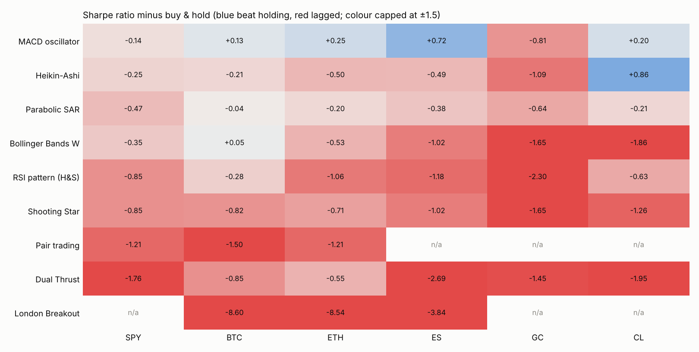
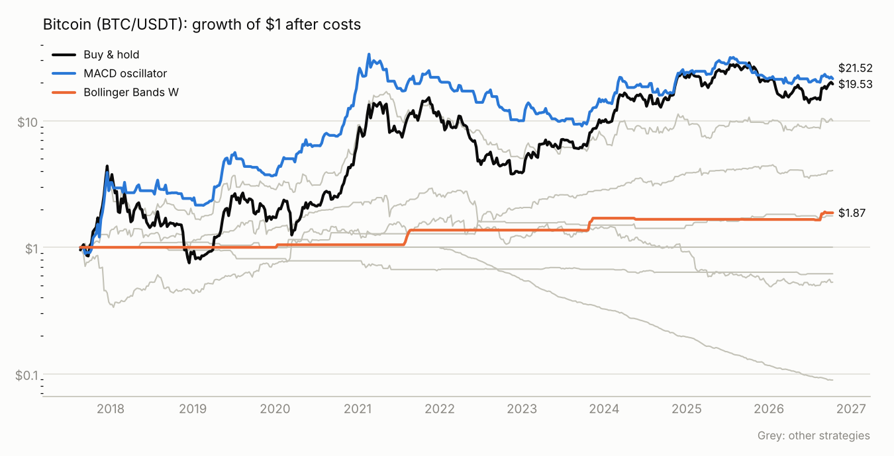
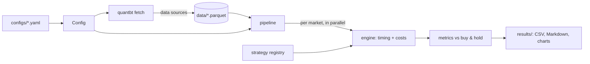

# quantbt

**Config-driven backtests of classic quant trading strategies on equities, crypto and futures.**

[](https://github.com/aylinunel/aylintrade/actions/workflows/ci.yml)


`quantbt` re-implements nine strategies from
[je-suis-tm/quant-trading](https://github.com/je-suis-tm/quant-trading), removes their look-ahead
bias, and runs them all under **one set of rules**: identical execution timing, trading costs on
every trade, and buy-and-hold over the same dates as the benchmark. That makes the results
comparable across strategies and markets.

> Research only, not financial advice. Past performance, especially on one year of futures data,
> says little about the future.

## Results

After costs, **6 of 48 strategy-market tests beat simply holding the asset** on Sharpe ratio
(return per unit of risk). Full tables are in [`results/latest/summary.md`](results/latest/summary.md).

| Market | Data | Buy & hold Sharpe | Buy & hold / yr | Best strategy | Sharpe | Per yr | Trades |
|---|---|---:|---:|---|---:|---:|---:|
| S&P 500 ETF (SPY) | 1995–2026 | 0.66 | 11.2% | MACD oscillator | 0.52 | 5.5% | 185 |
| Bitcoin (BTC/USDT) | 2017–2026 | 0.82 | 38.3% | MACD oscillator | 0.95 | 39.8% | 85 |
| Ethereum (ETH/USDT) | 2017–2026 | 0.71 | 26.1% | MACD oscillator | 0.95 | 48.9% | 85 |
| S&P 500 E-mini (ES) | 2025–2026 | 1.02 | 19.0% | MACD oscillator | 1.74 | 17.9% | 6 |
| Gold (GC) | 2025–2026 | 1.65 | 55.6% | Parabolic SAR | 1.01 | 21.6% | 12 |
| Crude oil (CL) | 2025–2026 | 1.26 | 69.8% | Heikin-Ashi | 2.12 | 22.2% | 8 |

* Nothing beat holding SPY over 31 years.
* The MACD trend filter is the only consistent winner, on crypto, and most of that edge came
  before 2022 (see `results/latest/robustness.csv`).
* High-turnover intraday strategies (Dual Thrust, London Breakout) lose to trading costs.
* The futures rows rest on a handful of trades over about a year: treat them as anecdotes.





## Quick start

```bash
git clone https://github.com/aylinunel/aylintrade && cd aylintrade
pip install -e ".[plot]"        # Python 3.11+

quantbt list                    # strategies, data sources, markets
quantbt fetch                   # download data into data/ (~200 MB, cached)
quantbt run -j 4 --charts       # backtest everything; results in results/latest/
quantbt robustness              # parameter, cost and sub-period checks
```

Run a subset:

```bash
quantbt run -m BTC ETH -s buy_and_hold macd pair_trading -o results/crypto
```

No API keys are needed: all data comes from free datasets hosted on GitHub.

## Strategies

| Id | Kind | Rule |
|---|---|---|
| `buy_and_hold` | position | Benchmark: always fully invested |
| `macd` | position | Long while the 10-day average is at or above the 21-day average |
| `parabolic_sar` | position | Long while the SAR is below the price |
| `heikin_ashi` | position | Scales into up to 3 longs on Heikin-Ashi candle signals |
| `bollinger_w` | position | Long on a double-bottom breakout, exit on band contraction |
| `rsi_head_shoulders` | position | Short a head-and-shoulders top, cover on an RSI rebound |
| `shooting_star` | position | Short after a confirmed shooting star, ±5% stop or 7 days |
| `dual_thrust` | intraday | Breakout from the open, flat at the close (daily bars) |
| `london_breakout` | intraday | Break of the 07:00 UTC hour's range at the London open (hourly bars) |
| `pair_trading` | pair | Trades the z-score of a cointegrated spread, market-neutral |

The original repo's options straddle is not included: it needs historical option prices, which
are not freely available.

## How it works



| Package | Responsibility |
|---|---|
| `quantbt.config` | Typed, validated YAML config: markets, costs, strategy parameters |
| `quantbt.data` | OHLCV schema, pluggable sources (`@register_source`), Parquet cache |
| `quantbt.strategies` | Strategy interfaces (position / intraday / pair) and the registry (`@register`) |
| `quantbt.engine` | Execution timing, cost model, performance metrics |
| `quantbt.pipeline` | Runs every strategy on every market, in parallel processes |
| `quantbt.robustness` | Parameter grids, cost multipliers, sub-period splits |
| `quantbt.reporting` | CSV, Markdown summary and PNG charts |

**Rules every strategy shares** (details in [docs/methodology.md](docs/methodology.md)):

* A signal formed at a bar's close trades from the next bar, so nothing sees the future. The
  test suite enforces this for every strategy by re-running it on truncated and shocked data.
* Each change in position pays a cost per side: 0.05% (SPY), 0.10% (crypto), 0.03–0.05% (futures).
* Full capital per strategy (pair trading: half per leg). Idle cash earns nothing; shorts pay no
  borrow fee.

## Scaling up

* **New market:** add a block under `markets:` in a config. Any local CSV works through the
  `csv` source.
* **New strategy:** one file with a dataclass and `@register`; it then works in configs, the
  CLI, tests and reports.
* **New data vendor:** subclass `DataSource` and decorate with `@register_source("name")`.
* **More compute:** `-j N` runs markets in parallel; the `Backtest` GitHub Action runs the full
  study on fresh data and uploads the results.

Step-by-step examples are in [docs/extending.md](docs/extending.md).

## Development

```bash
pip install -e ".[dev]"
make lint      # ruff + mypy
make test      # 66 offline tests, ~90% coverage
```

CI runs lint, types and tests on Python 3.11–3.13 for every push and pull request.

## Data sources

| Market | Source | Coverage |
|---|---|---|
| SPY, DIA | [Johnbrick123/sp500-data](https://github.com/Johnbrick123/sp500-data), dividend-adjusted | 1995 → today |
| BTC, ETH | [finom/static-klines](https://github.com/finom/static-klines) (Binance) | daily 2017 →, hourly 2022 → |
| ES, NQ, GC, CL | [axb0306/cme-futures-ohlc](https://github.com/axb0306/cme-futures-ohlc) | about one year |

## License

Apache-2.0. Strategy logic is adapted from je-suis-tm/quant-trading (Apache-2.0); see
[NOTICE](NOTICE).
