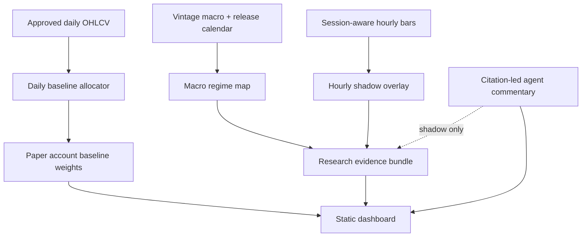

# Macro and hourly research architecture

## Purpose

This design adds macroeconomic and hourly analysis without creating an untestable composite trading model. The existing daily AylinTrade allocator remains the baseline. Macro and intraday outputs are first evaluated as isolated, versioned research overlays.

## Layering model



The dotted path is intentional. No macro, hourly or LLM signal changes the paper account in the first release.

## Macro data model

### Core schemas

```text
MacroObservation
  series_id: string
  observed_period: datetime/date
  value: number | null
  units: string
  released_at: datetime | null
  retrieved_at: datetime
  available_at: datetime
  vintage_id: string
  source_id: string
  status: approved-research | quarantined | unavailable

MacroEvent
  event_id: string
  name: string
  scheduled_at: datetime
  actual_released_at: datetime | null
  timezone: IANA timezone
  source_url: string
  status: scheduled | released | revised | cancelled

MacroRegime
  as_of: datetime
  labels: list[RegimeLabel]
  underlying_observations: list[ObservationReference]
  rule_version: string
  data_status: approved | partial | unavailable
```

### Initial series set

- **Rates / curve:** two-year and ten-year Treasury yields, curve slope, real-yield proxy.
- **Inflation:** CPI headline/core, three- and twelve-month changes, release metadata.
- **Labor / growth:** payrolls, unemployment, initial claims, industrial production.
- **Credit / liquidity:** high-yield/investment-grade spread proxy and a disclosed financial-conditions proxy.
- **Dollar:** broad dollar index or a documented alternative.
- **Volatility:** VIX/equivalent and realized portfolio volatility.

The release calendar is a separate dataset from the values. It protects against treating the month being measured as the time when the market learned the value.

### Causal availability algorithm

For a decision timestamp `t`:

1. Select an observation only if `available_at <= t`.
2. If a series revision has a later `available_at`, do not use it at `t`.
3. Forward-fill macro values only from their actual release time, never from their observation period end.
4. Record the selected vintage and release timestamp in the evidence bundle.
5. Fail the study when the required vintage or availability timestamp is missing.

This is necessary because ALFRED archives values with real-time periods and FRED documents how historical information sets are requested. [1] [2]

## Hourly data model

### Instrument session catalogue

Every hourly asset has an explicit rule:

| Instrument class | Timezone/session policy | Decision convention |
|---|---|---|
| US ETF | America/New_York regular session; no synthetic closed-hour bars | Feature ends at a completed regular-session bar; fill at next eligible bar |
| CME/COMEX/NYMEX future | Named contract and source-specified session; documented roll schedule required | Use only closed bars from a validated continuous-contract series |
| Crypto spot | UTC, 24/7 | Feature ends at candle close; decision/fill not before the next completed bar |

The application stores UTC instants and separately displays market-local time. It does not coerce crypto weekends or ETF closed hours into the same return grid.

### Feature specification

Each feature uses only closed bars at or before `t`:

```text
trend_4h / trend_12h / trend_24h / trend_72h
  = trailing return plus close-versus-trailing-average status

rv_24h / rv_168h
  = annualized realized volatility from completed hourly returns

range_percentile
  = current completed-bar range relative to trailing distribution

session_state
  = regular, overnight, weekend, maintenance, or unavailable

quality_status
  = complete, missing, stale, duplicate-resolved, quarantined, or invalid
```

The first output is a `HourlyOverlayRecord`:

```text
HourlyOverlayRecord
  market: string
  as_of: datetime
  regime: risk_on | neutral | risk_off | data_invalid
  proposed_timing: enter | wait | maintain | exit_review
  feature_version: string
  source_snapshot: string
  quality_status: string
  influence: shadow
```

`proposed_timing` is analytical language for a registered counterfactual. It is not a public instruction to trade and has no effect on the paper-account units.

### Source gates

A source can be used only when all checks pass:

1. Rights for the intended storage/display use are documented.
2. The exact source snapshot/commit and retrieval time are recorded.
3. Bar interval, timestamp meaning, timezone and completion rule are known.
4. Duplicate, ordering, OHLC, negative/zero price, gap and stale-data validation passes.
5. The market/session calendar is attached.
6. Coverage supports a predeclared warm-up and holdout period.
7. The data does not contain the target bar at feature formation time.

The existing repository adapters support 1-hour CSV and Binance/CME inputs, but the current data sources do not meet this gate automatically. Community GitHub datasets remain quarantine inputs until the above proof exists.

## Experiment protocol

### Registered hypotheses

The first experiments are intentionally narrow:

- H1: A daily baseline with the hourly overlay disabled.
- H2: The same daily baseline with a shadow hourly timing counterfactual.
- H3: A daily baseline with a macro regime label displayed but no allocation effect.
- H4: A future pre-registered, capped macro or hourly risk-off reduction, tested only after H2/H3 have complete data lineage and holdout evidence.

No experiment is selected because it has the best full-history Sharpe ratio.

### Walk-forward evaluation

1. Split data into chronological expanding training, validation and holdout blocks.
2. Define all feature windows, thresholds, cost/slippage and cash treatment before running the holdout.
3. Purge/embargo observations around a holding-period label to prevent overlap leakage.
4. Refit/select only using the training/validation sections of each fold.
5. Report every registered variant, not only the winner.
6. Repeat under delayed fills, higher costs, missing-data removal, no-crypto subset and relevant macro regimes.

### Minimum acceptance output

Every run produces:

- A data coverage report and snapshot hashes.
- A causality test that future changes cannot affect earlier decisions.
- Baseline/variant equity curves, drawdown, annualized return, volatility, Sharpe, Sortino, Calmar, turnover and exposure.
- A matched-period benchmark table.
- Feature availability and missingness summary.
- A failure log and a declaration of what was not tested.

## Agent commentary architecture

The first agent mode is `commentary_shadow`:

```text
facts + macro release calendar + data-quality flags
  -> source discovery / analyst reports
  -> citations and counterarguments
  -> deterministic sanitization and source-link validation
  -> immutable commentary record
  -> dashboard
```

The record holds model identifier, vendor, prompt/configuration version, input hashes, current retrieval time, cited source URLs, tool errors and output status. It is excluded from retrospective historical simulation. The deterministic existing guard can calculate a hypothetical capped trim, but that trim stays in the shadow ledger until an explicit forward-study gate is met.

## References

[1]: https://fred.stlouisfed.org/docs/api/fred/alfred.html "ALFRED archival vintage-data documentation"
[2]: https://fred.stlouisfed.org/docs/api/fred/realtime_period.html "FRED real-time-period documentation"
[3]: https://www.bls.gov/schedule/news_release/cpi.htm "U.S. Bureau of Labor Statistics CPI release schedule"
[4]: https://www.bls.gov/schedule/news_release/empsit.htm "U.S. Bureau of Labor Statistics Employment Situation release schedule"
[5]: https://www.newyorkfed.org/research/calendars/nationalecon_cal "New York Fed economic indicators calendar"
