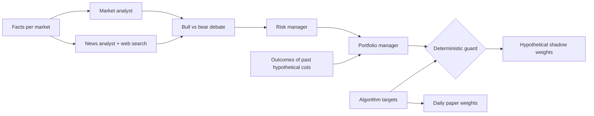

# Methodology

## Scope boundary

AylinTrade is a **long-only, paper-only research system**. It has no broker integration, order endpoint, leverage, short selling, funding flow or personalised recommendation. The daily portfolio, macro context, hourly layer and agent commentary are deliberately separated so a new feature cannot quietly change an existing allocation.

## Daily baseline algorithm

Defined in [`src/aylintrade/algorithm.py`](../src/aylintrade/algorithm.py); every setting is in [`configs/default.yaml`](../configs/default.yaml).

| Step | Rule | Setting |
|---|---|---|
| 1. Trend score | Eight votes per market: price above its 1, 3, 6 and 12-month average, and positive return over each horizon. Score = share of up-votes. | `horizons: [21, 63, 126, 252]` |
| Core holding | Each market's score becomes `0.25 + 0.75 × score`: a quarter of the full position is always held. | `trend_floor: 0.25` |
| 2. Risk parity | Weight ∝ score ÷ 60-day exponential volatility. | `vol_span: 60` |
| 3. Volatility target | Scale the book to 10% expected annual volatility using a 126-day covariance estimate, never above 100% gross. | `target_vol: 0.10`, `cov_window: 126`, `max_gross: 1.0` |
| 4. Rebalance band | Trade only when a holding differs from target by more than three percentage points; opening and closing remain tradable. | `rebalance_band: 0.03` |

A down-trending market is partly held as cash, never shorted. The reported results therefore describe a long-only/cash construction, not a long/short trend strategy.

## Daily study rules

| Rule | Detail |
|---|---|
| Calendar | Business days. Crypto weekend moves are booked on Monday; holidays are forward-filled as a zero return. |
| Timing | Weights decided at the close of day *t* earn day *t+1* return in the study. |
| Drift | Holdings drift with prices between trades; the band compares target against drifted weights. |
| Costs | Fixed fraction of traded value per side: 0.05% for ETFs and 0.10% for crypto. No market-impact model is claimed. |
| Benchmarks | SPY bought and held, equal weight in every market and the same algorithm with `trend_floor: 1` (always-invested risk parity). |
| Evaluation | From 2006-01-01 after a one-year warm-up. Sharpe uses zero risk-free rate. |

`tests/test_algorithm.py` recomputes weights from truncated histories and histories with future prices shocked; earlier weights must be identical. This is a causality check on the implemented calculation, not a proof that the raw inputs are point-in-time or survivorship-free.

## What the reported results say

- The current repository study reports lower annualized return than SPY, with lower volatility and drawdown. It is a risk-adjusted baseline, not a claim to beat the index on raw return.
- The always-invested risk-parity benchmark is close. Most apparent improvement comes from diversification and risk-based sizing; the incremental trend contribution is small and may be noise.
- The figures are **author-reported historical simulations** from the repository's current adapters and fixed cost model. They require a separately pinned, rights-cleared data reproduction before being described as independently verified.

## Agent commentary and shadow ledger

Defined in [`src/aylintrade/agents.py`](../src/aylintrade/agents.py), settings under `agents:`.

- The analysts and debaters use `claude-sonnet-5-5`; the portfolio manager uses `claude-opus-5-5` through a forced structured tool call.
- The guard is code, not a model. A hypothetical trim is `target × keep`, with `keep` clamped to `[1 − max_cut, 1]`. It can only reduce a hypothetical position, never open, add or short one.
- The default `commentary_shadow` mode leaves actual paper weights equal to the deterministic target and persists a separate `shadow_final`. `capped_trim` is an explicit future research mode, not the default behaviour.
- Missing, unreadable or failed model output means target remains unchanged. Model-written text is escaped, source links are constrained to `http`/`https`, and commentary carries provenance rather than authority.
- The committee is not backtested. Five trading days after a hypothetical decision, the system settles `(shadow_final − target) × market return` in a separate shadow ledger. That outcome is not included in historical strategy performance.

## Macro research boundary

The current macro view contains rates/curve, inflation, labor/growth, credit, dollar and volatility context. It is generated from public FRED graph series for **current display only**.

A future historical macro study must attach all of the following to each observation:

- `observed_period`, `released_at`, `retrieved_at`, `available_at`, `vintage_id` and source identifier;
- the official release calendar timestamp and timezone;
- the exact historical vintage or a documented snapshot hash;
- an explicit missing/revision policy.

A historical study may use a value only when `available_at` is no later than its decision timestamp. Current FRED graph values do not establish this evidence; they are excluded from historical allocation and strategy tests. ALFRED vintages and official BLS/New York Fed release schedules are the intended approval path.

## Hourly research boundary

The hourly overlay is independent from daily allocation. Its candidate features use only completed bars:

- 4/12/24/72-hour trailing trend;
- 24/168-hour realized volatility;
- range, session state and a data-quality flag.

ETF regular sessions, named continuous-futures contracts and 24/7 crypto retain their own calendars. The system never inserts synthetic closed-hour bars to align them. A future eligible experiment would execute no earlier than the next market bar.

The current mode is `shadow`: it logs no allocation-changing records. A source must pass rights, snapshot/version, coverage, timezone, bar-close, duplicate/gap/OHLC, session and continuous-roll gates before an hourly result can move out of quarantine.

## Paper account

[`src/aylintrade/paper.py`](../src/aylintrade/paper.py) starts with $100,000 of simulated capital and runs one daily close-based paper accounting event per new day. It uses the baseline's fixed costs and rebalance band, records state/ledger/trades/decisions, and refuses to trade if any portfolio market has been stale for more than seven days.

The account is public and auditable only to the extent its underlying source data, execution assumptions and workflow records allow. It is a record of simulated accounting—not a broker statement or a live track record.

## Known limitations

- Market-on-close-style study timing and fixed costs do not model spreads, slippage, market impact, liquidity or taxes.
- ETF source data are dividend-adjusted; BTC/ETH use Binance spot through a community cache. Corporate actions, revisions, data rights and exact provider snapshots require separate review.
- Futures are not part of the portfolio. The reviewed free data are short, stale and lack a documented continuous-roll methodology.
- Twenty years include only a small number of major crises. The trend increment against always-invested risk parity is small and may be noise.
- Current macro context and all web/LLM outputs are excluded from historical features until they satisfy the documented point-in-time evidence requirements.
