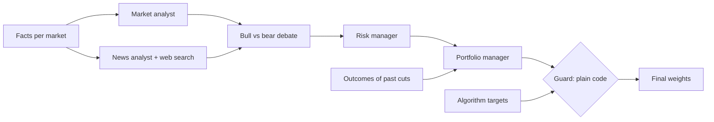

# Methodology

## The algorithm

Defined in [`src/aylintrade/algorithm.py`](../src/aylintrade/algorithm.py); every setting is in
`algorithm:` in [`configs/default.yaml`](../configs/default.yaml).

| Step | Rule | Setting |
|---|---|---|
| 1. Trend score | Eight votes per market: is the price above its 1, 3, 6 and 12-month average, and is the return over each of those horizons positive. Score = share of up-votes. | `horizons: [21, 63, 126, 252]` |
| Core holding | Each market's score becomes `0.25 + 0.75 × score`: a quarter of the full position is always held, the trend decides the rest. | `trend_floor: 0.25` |
| 2. Risk parity | Weight ∝ score ÷ volatility (60-day exponential), so each market contributes similar risk. | `vol_span: 60` |
| 3. Volatility target | The whole book is scaled to an expected 10% a year, using the covariance of the last 126 days; never more than 100% invested. | `target_vol: 0.10`, `cov_window: 126`, `max_gross: 1.0` |
| 4. Rebalance band | A holding is only traded when it is more than 3 points of the account away from its target. Opening and closing a position always trade. | `rebalance_band: 0.03` |

Long-only: a market in a downtrend is partly held as cash, never shorted. Shorting was tested
(long/short trend scores) and lost money, because stocks and crypto drift upward over time.

## Backtest rules

| Rule | Detail |
|---|---|
| Calendar | Business days. Crypto's weekend moves are booked on Monday. Holidays are forward-filled (a zero return). |
| Timing | Weights decided at the close of day *t* are traded at that close and earn day *t+1*'s return. |
| Drift | Between trades, holdings drift with prices; the band compares the target with the *drifted* weights. The backtest therefore pays for every rebalance it needs. |
| Costs | A fraction of traded value per side: 0.05% for ETFs, 0.10% for crypto. |
| Benchmarks | SPY bought once and held; equal weight in every market; and the same algorithm with `trend_floor: 1` (risk parity, always invested). All pay the same costs. |
| Evaluation | From 2006-01-01, after a one-year warm-up. Sharpe uses a zero risk-free rate. |

`tests/test_algorithm.py` checks that no weight ever uses a future price: it recomputes the
weights on truncated histories, and on histories where every later price is halved, and
requires identical results.

## What the results say

* The portfolio's Sharpe ratio is about 0.9 against 0.64 for holding SPY, with half the
  volatility and less than half the worst loss. Its yearly return is lower (about 8.4% against
  11%). It is built to be easy to stick with, not to beat the index on raw return.
* **Most of that comes from diversification and risk-based sizing**, not from the trend
  signal: the always-invested risk-parity benchmark scores nearly the same. The trend tilt adds
  a little Sharpe and cut 2008 to −6% (risk parity −15%, SPY −37%). It did not help in 2022
  (−17%), when stocks and bonds fell together and a long-only portfolio had nowhere to hide.
  The stress tests list every variant tried while designing the algorithm, including the ones
  that lost.
* Higher volatility targets earn more per year but cannot exceed 100% invested; leverage is
  deliberately off.

## The agent committee

Defined in [`src/aylintrade/agents.py`](../src/aylintrade/agents.py), settings under `agents:`.

* The analysts and debaters run on `claude-sonnet-5-5`; the portfolio manager on
  `claude-opus-5-5`, through a forced tool call so its decisions are structured data.
* **The guard is code, not a model.** Final weight = target × keep, with keep clamped to
  [1 − `max_cut`, 1]. The committee can only reduce a position, by at most half by default; it
  can never open, add or short. A missing or unreadable decision keeps the algorithm's weight
  and is flagged, never read as "Hold".
* If the API key is missing or any call fails, the algorithm trades alone that day.
* **The committee is not backtested**: a language model knows how history turned out, so any
  backtest of it would quietly use the future. It is measured forward instead: every decision
  is logged in `paper/decisions.csv`, and five trading days later its effect is settled as
  (final − target) × the market's return. The dashboard shows the running total, and the
  portfolio manager reads its recent outcomes before each meeting.
* Cost: six model calls and up to five web searches a day; a few dollars a month at current prices.

## Paper account

[`src/aylintrade/paper.py`](../src/aylintrade/paper.py) starts with $100,000 of simulated money
and trades one day per run at the day's close, with the same costs and band as the backtest.
State lives in `paper/` and is committed by the daily GitHub Action, so the full record is
public and auditable. Re-running on the same data does nothing. The daily run refuses to trade
when any portfolio market has had no new price for 7 days.

## Known limitations

* Fills at the close assume market-on-close orders; there is no slippage model beyond the fixed
  cost, and no market-impact limits.
* ETF data is dividend-adjusted; crypto data is Binance spot (BTC/USDT, ETH/USDT).
* **Futures are not tested.** The free dataset holds about one year and stops in April 2026,
  shorter than the two years the algorithm needs (one to warm up, one to test). Gold and
  S&P 500 exposure come through GLD and SPY. A longer futures source can be added as a data
  source and the markets switched to `portfolio: true`.
* Twenty years include only a few crises. The edge over always-invested risk parity is small
  and could be noise.
